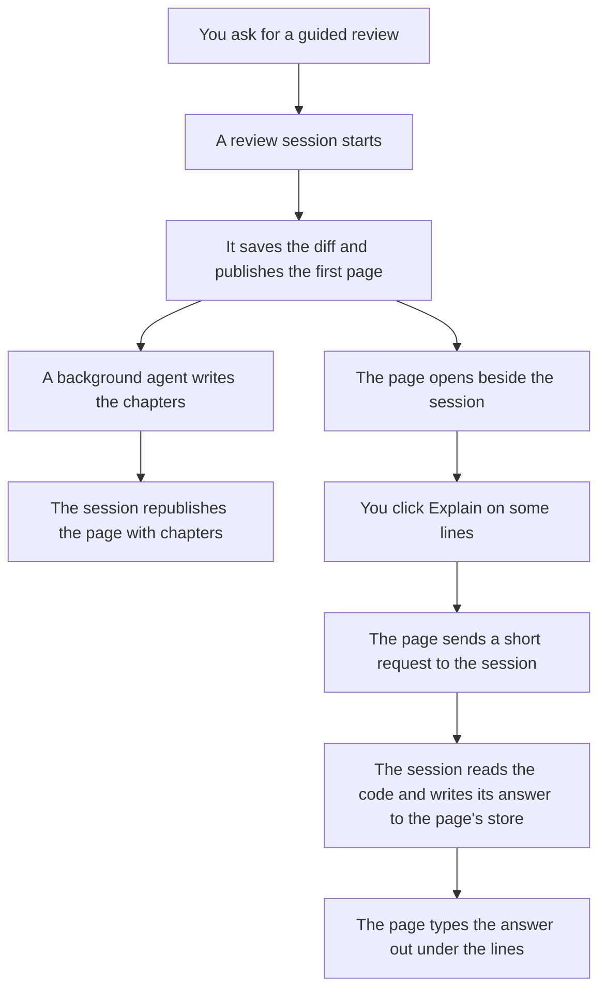

# guided-review

Read a code change in the order that makes sense, not the order the diff happens to list it.

`guided-review` turns a pull request, a branch, or your uncommitted work into a private page with three tabs:

- **Overview**: the change as analysed from the code. What it does, what changed (each linked to its chapter), the risks (the files that need the closest reading and what they affect, plus anything cross-cutting), and the totals at a glance.
- **Guide**: the change in chapters, one at a time: the heart of it first, what follows from it next, the wiring last. Each chapter's overview and file list stay in a column beside its diffs.
- **Files**: every changed file whole, in patch order, as the diff lists it.

You read the page beside Claude, and you can ask about any line:

- **Explain**: mark lines and click Explain. Claude reads the code around them at the reviewed version (the whole file, the callers, the history) and types the answer out under those lines.
- **Comment**: mark lines and leave a comment, or send it to Claude to discuss.

Every review gets a session of its own, so the answers come from a context that knows the repository and the change, and nothing else you happen to be working on.

## Using it

Ask Claude for a guided review:

```text
/guided-review #631
/guided-review https://github.com/owner/repo/pull/631
/guided-review my-feature-branch
/guided-review
```

With no argument it reviews your uncommitted work. Plain requests work too, such as "give me a guided review of PR 631". Installed as a plugin, the slash command is `/guided-review:guided-review`.

What happens:

1. A new session named `🔍 Guided review: PR #631` starts. The rest happens there.
2. Within about a minute, the page opens beside that session on its Files tab. Explain and Comment already work.
3. In the background, Claude writes the chapters and the Overview. The page reloads with its Overview and Guide tabs, and any answers already given stay under their lines.
4. You read the page from that session. Each click on Explain or Comment goes to the session beside the page, which answers it.

### On the page

| To | Do |
| --- | --- |
| Mark a line | Click its line number |
| Mark several lines | Drag across line numbers, or click one and shift-click another |
| Ask about marked lines | Click **Explain** in the bar under them |
| Ask about a whole hunk | Click **Explain** on the hunk's header |
| Comment on marked lines | Click **Comment**, then **Post comment** or **Send to Claude** |
| Clear the marks | Click **Clear**, or press Escape |
| Move between views | Use the **Overview**, **Guide** and **Files** tabs; each has its own address (`#overview`, `#guide-2`, `#files`) |
| Read the guide | Pick a chapter in the strip under the tabs, or use **Previous** and **Next** |
| See every changed file | **Files changed** on the Overview lists them all, highest attention first, with lines added and removed and the chapters they're in |
| Know where to look hard | Each file carries an **attention** tag (High, Medium, Low), the **kind** of change (Interface, Logic, Data, Config, Tests, Docs, Refactor, Generated) and an **Affects** line naming its blast radius. Rest the pointer on a tag for its meaning |
| Jump to a file | Click it in any file list, or a risk's file name |
| Track your progress | Tick a file's **Reviewed** box to fold it and mark it in the lists, and tick a chapter's **Reviewed** box to mark it ✓ in the strip |

Answers stay on the page, under their lines in both the Guide and Files. Reopen it later, or after the chapters arrive, and each answer is still there, folded.

## Requirements

- **Claude Code in the Claude desktop app.** The page is a private claude.ai Artifact that uses its comments and its built-in store, and each review starts its own session. Elsewhere, the skill still writes the guide and the page, but Explain needs a session the page can reach.
- **git**, and **Node.js 22** or later to render the page.
- **The GitHub CLI (`gh`)**, signed in, for pull requests.

Your checkout is never changed. Claude reads a pull request with `git fetch origin pull/<n>/head` and `git show`, so your current branch and your files stay as they are.

## How it works



- **The diff is never retyped.** Claude writes only the reading order and the prose, in `guide.json`. `scripts/render.mjs` draws every diff line from the patch itself, and refuses to build a page unless every change in the patch sits in exactly one chapter.
- **Explain requests are pointers.** The page sends the session two short lines: the file and lines, and an id. The session reads the code itself and writes its progress and answer to the page's store, under that id. The page shows each step as it happens and types the answer out.
- **Answers are pinned to file and line**, not to their place on the page, so they survive the page being rebuilt with chapters.
- **Syntax colours** come from [highlight.js](https://highlightjs.org) 11.9.0, loaded from cdnjs, with a palette of the page's own in light and dark that stays clear of the diff's green and red. Each hunk is coloured as a whole, so comments and strings that span lines keep their colour. If the library can't load, the diff shows uncoloured.

## Files

| File | What it is |
| --- | --- |
| [`SKILL.md`](SKILL.md) | The instructions Claude follows |
| [`scripts/render.mjs`](scripts/render.mjs) | Builds the page from `guide.json` and the patch. `--list` prints each file's hunks |
| [`test/harness.mjs`](test/harness.mjs) | Wraps a built page in a stand-in for the Artifact viewer, to test it in any browser |

### Testing the page without claude.ai

```bash
node scripts/render.mjs guide.json patch.diff guide.html
node test/harness.mjs guide.html harness.html
```

Serve `harness.html` from any local web server and open it. From the browser console, `__harness.answer(id, { place, steps, paragraphs })` plays an answer the way a review session writes one, and `__harness.sent` lists what the page sent. Add `?can=no_session`, `?comments=0` or `?db=0` to the page's address to test the page without a session, without comments, or without the store.

## Credits

The reading order (the heart of the change first, its consequences next, the glue last) comes from [Plannotator](https://github.com/backnotprop/plannotator)'s Guided Review. This skill shares no code with it.
